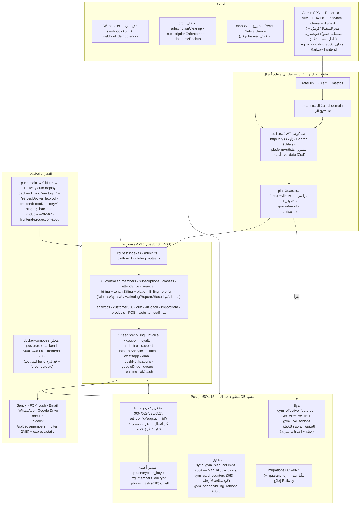

# GymCore ERP — خريطة المعمارية الحقيقية

> **هذا الملف هو مصدر الحقيقة المعماري الوحيد.** مولَّد من الكود الفعلي بتاريخ 2026-10-14 (حتى migration 067 + موجة §38).
> **قاعدة الالتزام:** أي milestone يُضيف مسارًا أو وسيطًا أو migration أو خدمة أو عميلًا جديدًا **يجب** أن يحدّث هذا الملف والمخطط أدناه في نفس الـcommit. لا نستخدم صورًا خارجية مولَّدة (مثل gitdiagram) لأنها تلتقط لقطة قديمة وتثبّت تجريدًا لا يطابق الواقع.

## المخطط

## الطبقات كما هي في الكود (بالمسارات)

| الطبقة | الواقع | المسار |
|---|---|---|
| عميل إداري | React 18 + Vite 5 + Tailwind + react-router 7 + TanStack Query 5 + i18next، يُبنى dist وتخدمه nginx | `src/` (صفحات: `gym-admin`, `super-admin`, `player`, `trainer`, `dashboards`, `settings`) |
| عميل موبايل | React Native مستقل بـnode_modules خاص | `mobile/src/` |
| مصادقة | JWT (hs) في كوكي `access_token` للوحة، Bearer للمسار المحمول، جلسة 300s قابلة للتمديد | `server/src/middleware/auth.ts`, `platformAuth.ts` |
| تعدد المستأجرين | حلّ subdomain → gym_id، ثم **RLS على مستوى القاعدة** عبر `set_config('app.gym_id')` لكل اتصال؛ الوضع الإداري الخاص يستخدم `app.gym_id = NULL` بسياسة صريحة بدل تعطيل RLS | `middleware/tenant.ts`, `config/database.ts`, migrations 029/030 |
| الباقات | السلّم: Starter 550/5,500 · Growth 900/9,000 · Pro 1,400/14,000 · Enterprise 2,500/25,000 (065)؛ إضافات `billing_addons` كتالوج + `gym_addons` إسناد بسعر مخفَّض وسريان/إلغاء (066)؛ الإلغاء لا يسحب ميزة تابعة للخطة (union فقط) | `services/billing.service.ts` (BillingEngine), controllers `platform*`, `middleware/planGuard.ts` |
| الحراسة | planGuard يستهلك `gym_effective_features/limit` من الـDB؛ مصطلح الموديولات: {products, dashboard, attendance, daily_reports} | `middleware/planGuard.ts`, migration 066 |
| التشفير والبيانات الحساسة | أرقام الهواتف مشفّرة عند الكتابة (trigger) + `phone_hash` للبحث؛ القراءة عبر `decrypt_sensitive`؛ مفتاح التشفير يُمرر لكل اتصال كـ`app.encryption_key` | migrations 018+, `config/database.ts` |
| منطق داخل الـDB | 064 trigger يوحّد gyms.plan_id↔plan_tier؛ 063 عداد كروت الأعضاء؛ دوال الخطة الفعّالة | migrations 063/064/066 |
| مسارات | 4 ملفات routes تغطي ~45 controller (تجميع مركزي) | `server/src/routes/{index,admin,platform,billing.routes}.ts` |
| خدمات | 17 خدمة (فوترة/فواتير/كوبونات/ولاء/تسويق/دعم/TOTP/تحليلات AI/واتساب/بريد/push/Drive/queue/realtime/stitch/aiCoach) | `server/src/services/` |
| مهام مجدولة | تنظيف الاشتراكات، إنفاذ الباقات، نسخة قاعدة بيانات | `server/src/cron/` |
| رفع ملفات | multer: `/api/upload/photo` (2MB، صور فقط، manager/receptionist) → `/uploads/members` + static serve عبر nginx/CSP | `server/src/routes/index.ts` (photoStorage), `app.ts` static |
| نشر | GitHub→Railway trigger على main (بناء تلقائي ~4د + migrations عند الإقلاع)؛ محليًا docker-compose؛ حاويات: postgres + backend + frontend(nginx dist) | `.github` + إعداد Railway (§29 بالتقرير), `docker-compose.yml` |

## فجوات معمارية معروفة (موثقة، لم تُحسم)

1. مسار حجز الحصص للأعضاء يمر بحارس الميزة `class_booking` وهو **ليس** ضمن مصطلح موديولات الباقات → سيُرفض 403 FEATURE_REQUIRED؛ يحتاج قرار مالك (§37ب).
2. كلمات مرور onboarding تُخزَّن نصيًا في `platform_admins.onboarding_data` (§34ج-أ — أمني، معلّق).
3. `routes/index.ts` ضخّم مركزية (4 ملفات مقابل 45 controller) — تقسيم per-domain مرشح عند نمو الفريق.
4. `mobile/` غير مرتبط بـworkspace معلن ولا يظهر في أي CI — يستحق قرارًا: تفعيل أو أرشفة.

## كيف تحدّث هذا الملف

- المخطط أعلاه Mermaid خام: عدّل العقد/الحواف ثم تحقق بالعرض في GitHub (Markdown native) أو في `ARCH_MAP.html` (يضم نفس المخطط عبر mermaid CDN).
- لا تُضف مربعًا لمنطق غير موجود في الكود؛ كل عقدة يجب أن يكون لها مسار مرجعي في الجداول أعلاه.
- التوثيق التفصيلي لكل milestone يبقى في `LOCAL_TESTING_REPORT.md` و`TODO.md`؛ هذا الملف للحالة الراهنة فقط بلا تاريخ ولا خارطة طريق.
